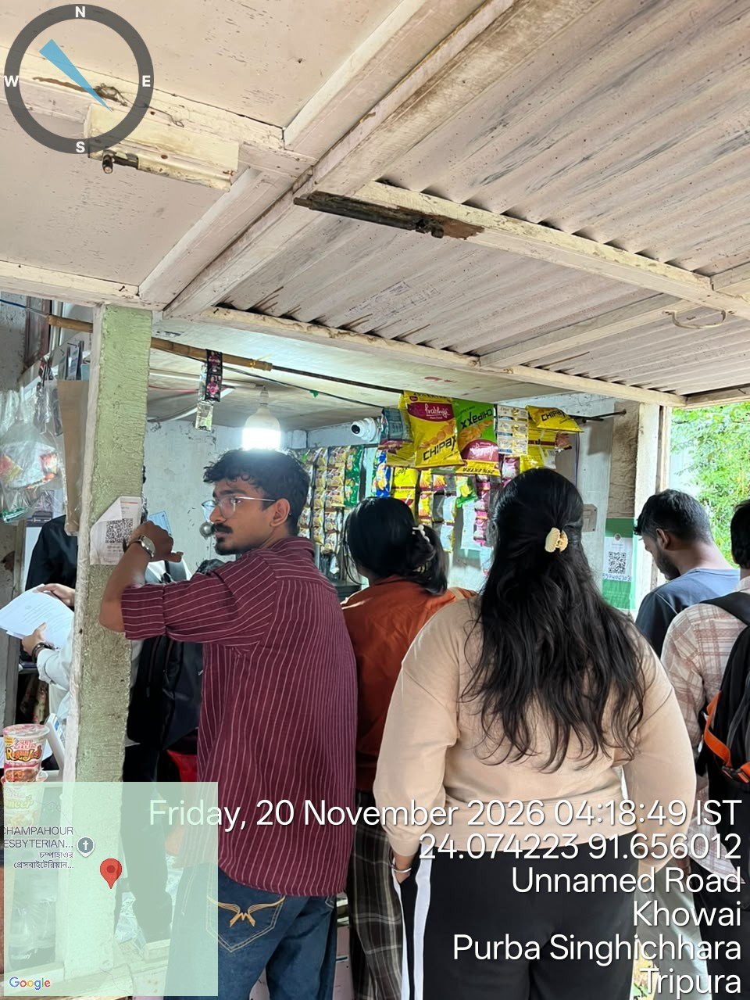
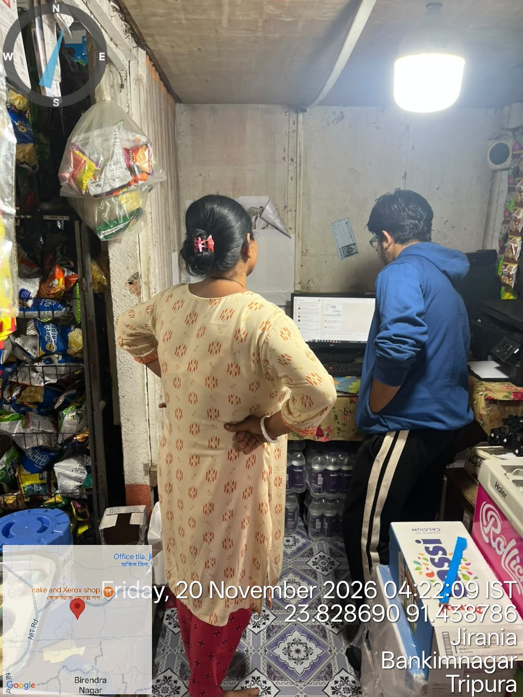
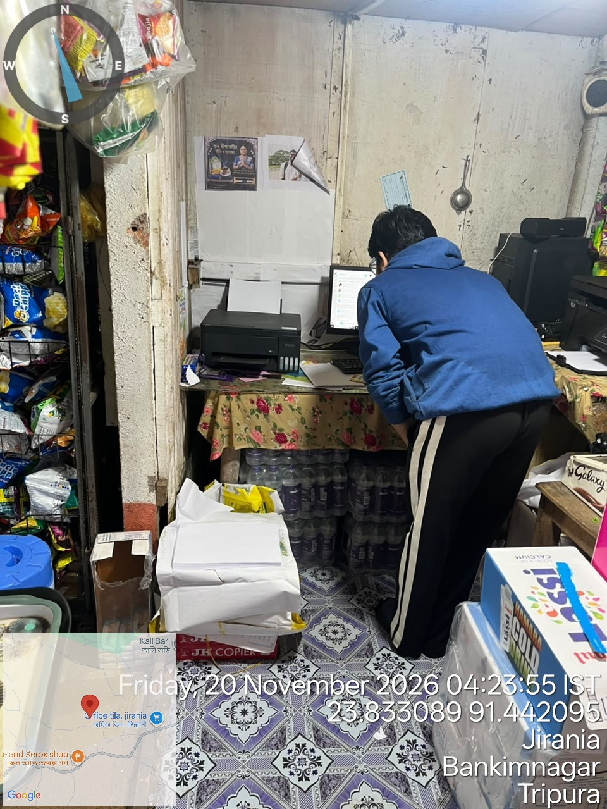
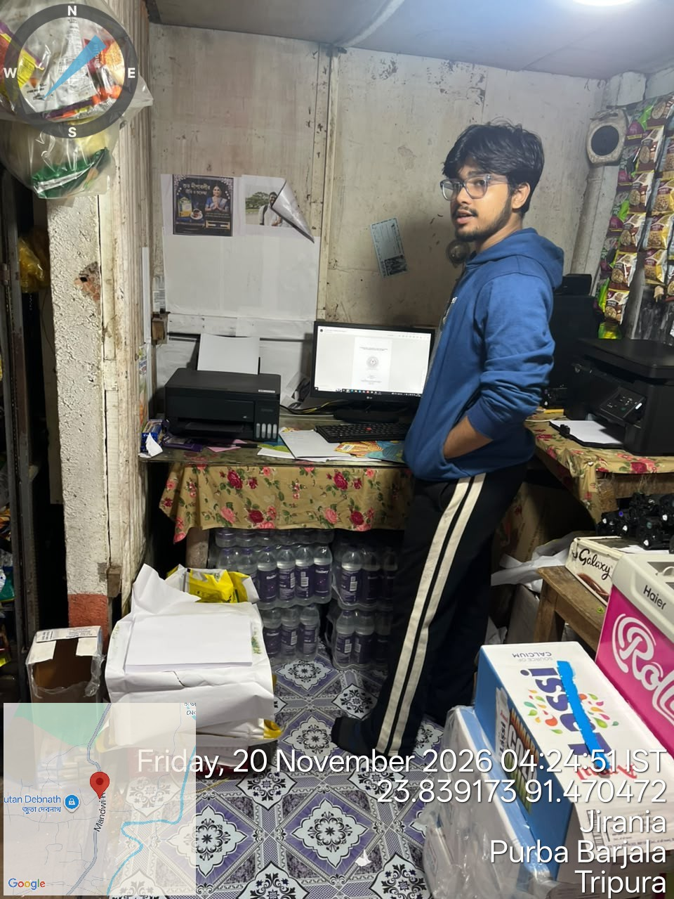

## Fieldwork Evidence

### Photo 1 — Visible crowd and mismanagement

- Timestamp: 20 November 2026, 4:18 PM
- Description: Crowd at the entrance; blocking vision

### Photo 2 — Print Job Setup Observation

- Timestamp: 20 November 2026, 4:22 PM
- Description: Observed Printing setup

### Photo 3 — Checked whatsapp for their workflow

- Timestamp: 20 November 2026, 4:23 PM
- Description: Looking at the long whatsapp printing job queues and seeing the timestamps as well

### Photo 4 — Print Job Observation

- Timestamp: 20 November 2026, 4:24 PM
- Description: starting to have a small discussion with the owner about my propsed solution.

## 2. Conversation with the Vendor

**Person:** Shital Ghosh  
**Role:** Printing Shop Owner / Operator  
**Location:** Beside ECE Department, NIT Agartala
**Date:** 20 November 2026  
**Duration:** Approximately 20-25 minutes

### Three things that he said:

1. **Handling multiple responsibilities:**
   "I have to single-handedly manage the shop, due to which all responsibilities cannot be handled at the same time. When I am attending other customers or I am doing additional shop works, incoming printing requests are often left unattended, and customers are required to wait until I am free of the prior work and only then their files can be processed. When these waiting periods become too long, customers often get frustrated and eventually leave without a word.
   Ironically, other times, mostly during thesis submission or admit card printing before exams, so many crowds often gather near the shop entrance, that eventually obstruct my visibility inside the shop and making potential theft difficult to notice."

2. **Manual file management and printing customization:**
   "I have to rely heavily on WhatsApp for receiving printing requests, due to which files often get mixed up, and identifying which document belongs to which customer becomes difficult and confusing.
   Then for every order, I also have to individually ask customers about their printing requirements, such as black-and-white or colour printing, the number of copies, selected pages, and other preferences, before configuring the printer accordingly.
   If you can really build a system where customers simply scan the QR, upload documents, select printing preferences, and print jobs processed automatically without requiring my constant intervention, it would be extremely helpful."

3. **Shop availability and offers:**
   "Since you are building this could you also consider adding another feature that lets students know whether my shop is currently open or closed? Sometimes students travel all the way here, only to find the shop closed.

   It would also be helpful if ongoing offers or discounts could be shown to students. And whenever the shop is open, I can also provide free hostel delivery for students"

### One thing that surprised me

"I was not able to manage the shop alone, so I had to call my sister from home to help me, even though she had her own household works to do. However, she was not much familiar with the technicality of computers, machines and printers, and there were several times when the printer got stuck while she was using it.
This not only put the machine at risk of damage but also created safety concerns for her, as she was not used to handling electrical equipment"

### Key Takeaway

The biggest challenge was not just handling printing requests but managing the entire shop single-handedly. Manual file handling through WhatsApp, repeated questions about printing preferences, long customer queues, and the lack of a proper order-management system made daily operations difficult. The need to call a family member for help also revealed how difficult it was to operate the printing equipment without technical knowledge.

This highlighted the need for a simple, automated printing system that reduces the vendor's workload, minimizes manual intervention, prevents order mix-ups, and makes the service more convenient for students.

## Dataset

The analysis uses 25 print-job records collected from Coffee House, beside the ECE Department, NIT Agartala, on 20 November 2026.

**Location:** Coffee House, beside ECE Department, NIT Agartala  
**Observation date:** 20 November 2026

The raw dataset is available at:

[`data/data.csv`](../data/data.csv)

Each row represents a print request and contains job details, submission methods, queue timings, processing durations, and workflow-related observations.

Due to the limited time available for fieldwork, it was not possible to record every required detail through direct observation alone. Therefore, some additional print-job records and their associated timestamps were retrieved from the shop's existing WhatsApp conversation history to supplement the observations.

The dataset consequently combines directly observed records with information obtained from the vendor's WhatsApp-based workflow. No synthetic or artificially generated records were introduced.

## Data Collection Method

Data was collected through direct observation of print-job handling at Coffee House, beside the ECE Department, NIT Agartala, on 20-11-2026.

The collection process involved:

- **Direct observation:** Print-job handling, customer interactions, vendor activities, and the overall shop workflow were observed during the field visit.
- **WhatsApp history review:** Due to the limited time available for fieldwork, additional print-job details and timestamps were retrieved from the vendor's existing WhatsApp conversations to supplement the directly observed records.
- **Job attribute recording:** Details such as submission method, page count, number of copies, print type, configuration requirements, and workflow-related issues were recorded based on available observations and WhatsApp records.

The resulting dataset contains 25 records combining these two sources. No synthetic or artificially generated records were included. Values that could not be reliably established were left blank.
